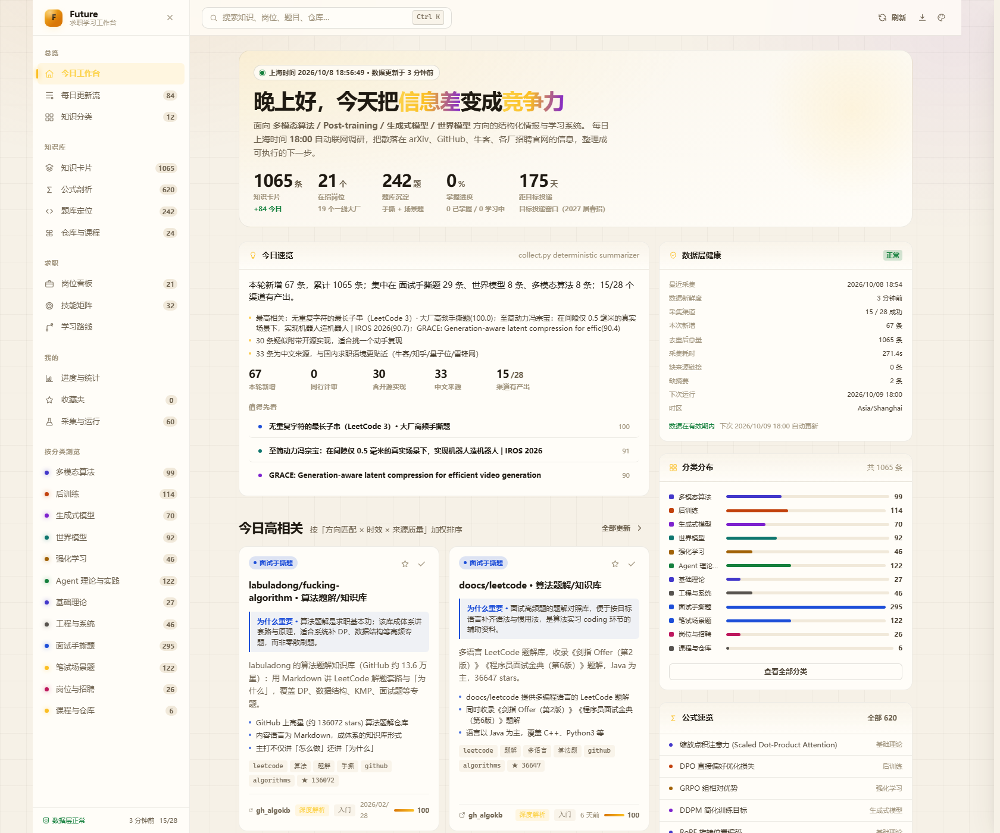
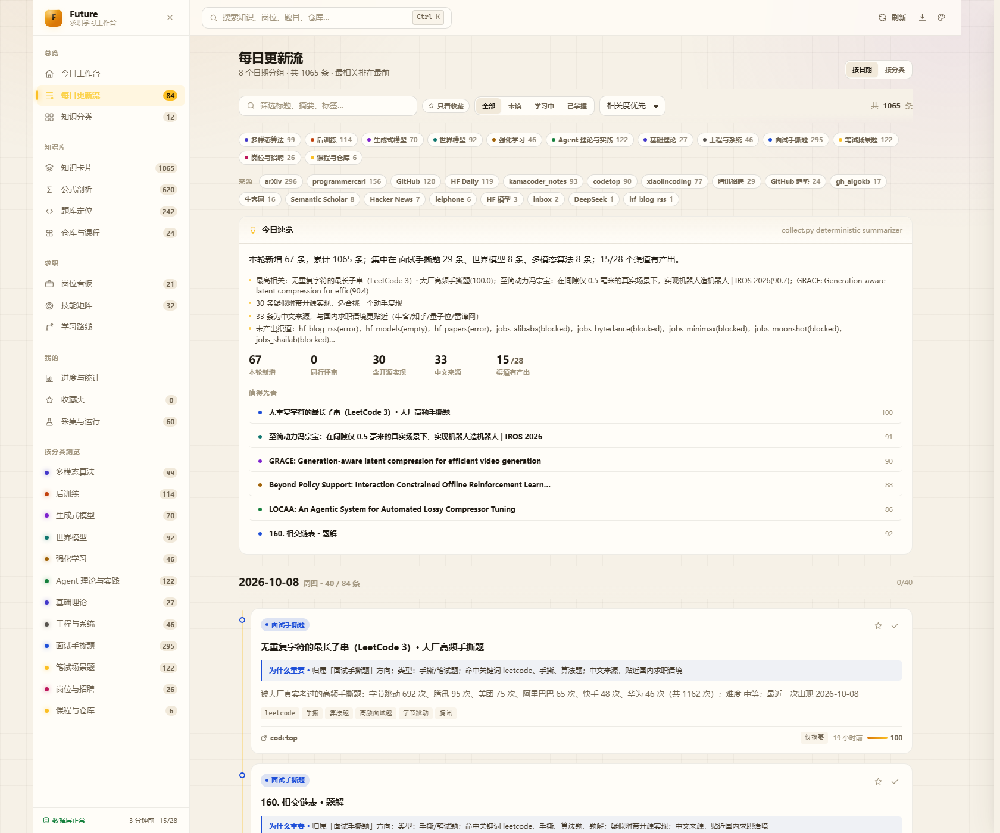
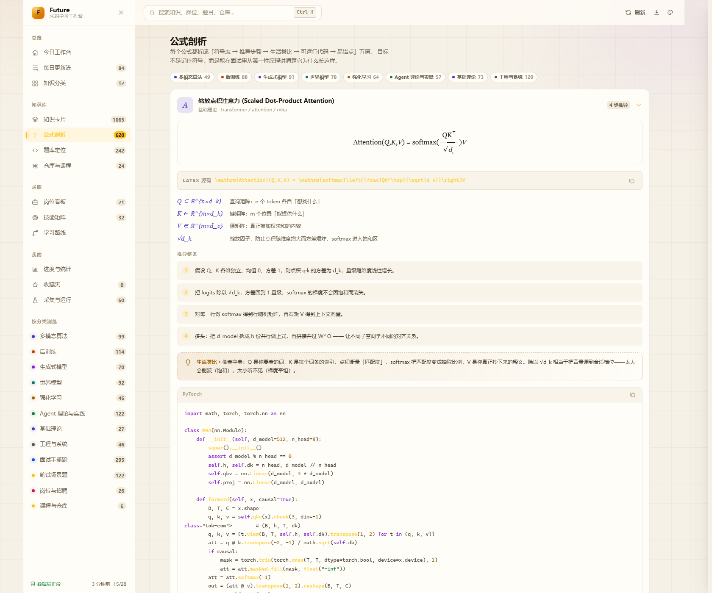
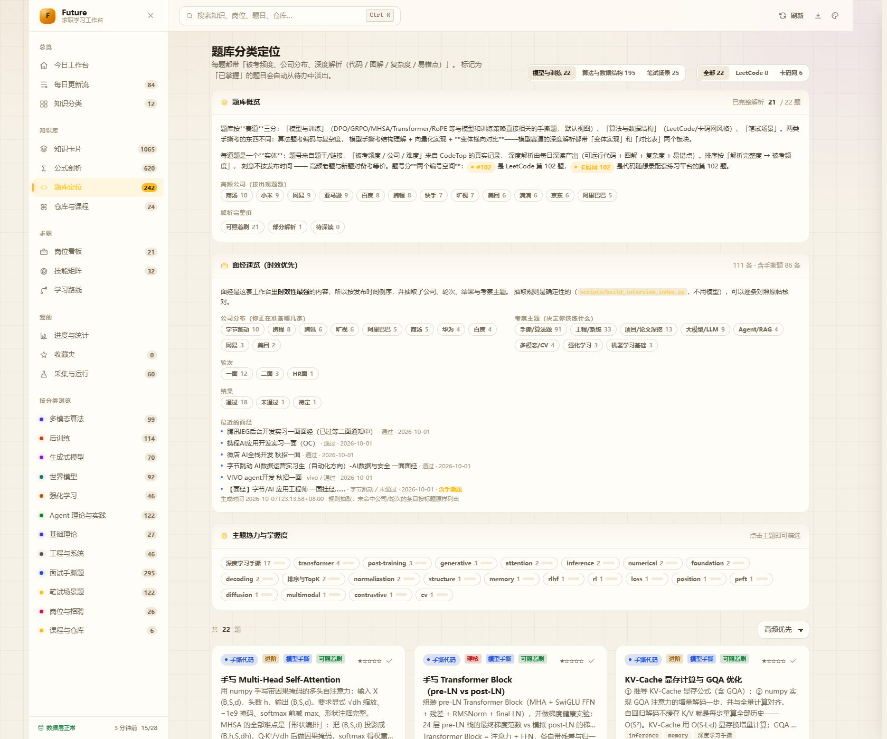
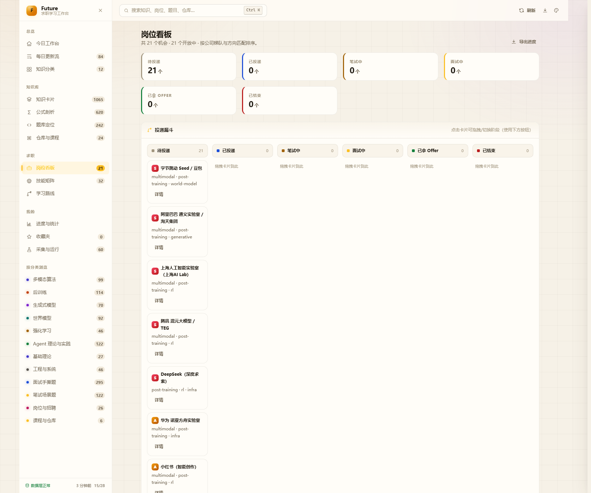

# Future · 求职学习工作台

> 面向 **多模态算法 / Post-training 后训练 / 生成式模型 / 世界模型** 方向的算法实习求职工作台。
> 每天上海时间 **18:00** 自动联网调研，把散落在 arXiv、HuggingFace、GitHub、代码随想录、卡码网、
> 各厂招聘官网的公开信息，整理成**可执行的知识卡片、五层公式剖析、题库与岗位看板**。

**在线使用（无需安装、手机可直接打开）：**

### 👉 https://future-job-workbench.app.workbuddy.host/

| | |
|---|---|
| 形态 | 纯静态站点（前端 + JSON 数据），无服务端、无数据库、无 CDN |
| 前端 | 原生 HTML/CSS/JS，13 个视图，`file://` 双击即可打开 |
| 采集 | Python 标准库实现（无第三方依赖），99 个渠道登记 / 28 个每轮实测 |
| 更新 | 每日 18:00 (Asia/Shanghai) 由定时任务自动采集 → 自检 → 深读 → 构建 → 发布 |
| 发布 | WorkBuddy 托管（国内直连、链接稳定），**不使用 GitHub Pages** |
| 当前规模 | 1161 张知识卡片 · 15 个分类 · 278 道题库 · 766 条公式 · 21 个岗位 · 8 条学习路线 |

---

## 目录

- [一、这是什么](#一这是什么)
- [二、界面](#二界面)
- [三、核心特性](#三核心特性)
- [四、系统架构](#四系统架构)
- [五、目录结构](#五目录结构)
- [六、快速开始](#六快速开始)
- [七、数据层契约](#七数据层契约)
- [八、每日自动更新流程](#八每日自动更新流程)
- [九、知识质量控制](#九知识质量控制)
- [十、采集范围与合规边界](#十采集范围与合规边界)
- [十一、发布方式](#十一发布方式)
- [十二、常用命令速查](#十二常用命令速查)
- [十三、文档索引](#十三文档索引)
- [十四、开源许可](#十四开源许可)

---

## 一、这是什么

求职信息的问题不是"信息太少"，而是**信息散、噪音多、看过就忘**：
一篇 arXiv 论文、一个 GitHub 仓库、一道手撕题、一条岗位 JD，分布在十几个站点上，
没有任何一处能把它们按你的目标方向串起来，也没有任何一处会告诉你"这条为什么重要"。

这个工作台把这件事做成一条**每天自动运行的流水线**：

```
公开渠道 ──► 规范化 ──► 四层去重 ──► 相关度打分 ──► 知识质量闸门 ──► 结构化落盘
                                                                    │
                              ┌─────────────────────────────────────┘
                              ▼
                    Agent 深读层（可选）
                    为高价值条目产出：图解 / 概念易读化 / 公式剖析 / 自检声明
                              │
                              ▼
                    静态前端（web/）← 只读 JSON，零依赖、零构建
```

**设计上的三个坚持**

1. **失败必须可见**。`manifest.status`、运行历史、渠道状态表会如实显示
   `blocked / error / empty`，不做"看起来一切正常"的假象。10 个渠道因登录墙 / WAF / 机器人挑战
   长期不可用，所以整轮状态是 `partial`——这是设计上的诚实，不是故障。
2. **只有一类改动能自动生效**：关键词微调（可回滚、影响面小、下一轮打分立刻体现）。
   分类增删、渠道升降级、评分公式、去重阈值、黑名单**一律需要人工批准**。
3. **不抓不该抓的**。对 robots.txt 禁止或需要登录的站点（小红书、BOSS直聘、拉勾、实习僧…），
   本项目的网络请求数为 **0**，改为人工导出 + 本地导入。

---

## 二、界面



| | |
|---|---|
|  |  |
|  |  |

更多截图见 [`docs/screenshots/`](docs/screenshots/)（由 `node scripts/verify-web.mjs` 全路由自动生成）。

---

## 三、核心特性

### 13 个视图

| 视图 | 内容 |
|---|---|
| **今日工作台** | 问候 + 关键指标、今日高相关、近 7 日采集量、本周学习安排、岗位投递漏斗、数据层健康、分类分布 |
| **每日更新流** | 按日期/分类分组的**时间线**，每条带相关度、来源、难度，支持多维筛选；顶部有「今日速览」 |
| **知识分类** | 15 个分类的采集目标、更新节奏、掌握进度；渠道优先级表；去重与更新规则说明 |
| **知识卡片** | 全量卡片，按相关度/时间/难度排序，可叠加分类、来源、标签、阅读状态筛选 |
| **公式剖析** | 五层结构：公式排版 → 符号表 → 推导链条 → 生活类比 → 可运行代码 → 面试易错点 |
| **题库定位** | 三赛道（算法手撕 / 笔试场景 / 模型手撕），主题热力与掌握度，逐题得分要点、踩坑、参考实现 |
| **仓库与课程** | 固定仓库（含学习计划与检查点）、课程、必读论文（按阅读顺序） |
| **岗位看板** | 投递漏斗看板（可拖拽切换阶段）、机会清单、按梯队排序、详情含面试流程与来源 |
| **技能矩阵** | 技能 × 岗位重要度 × 掌握度，直接算出该补哪个缺口 |
| **学习路线** | 分方向模块化路线：任务 + 交付物 + 验收标准，可勾选进度 |
| **进度与统计** | 分类掌握度、每日采集量、热度日历（90 天）、来源分布、收藏概览 |
| **收藏夹** | 跨视图的收藏聚合 |
| **采集与运行** | 运行历史、渠道清单与实测状态、定时任务信息、真实性自查、自我迭代提案 |

### 交互与设计系统

- `Ctrl/⌘ + K` 全局搜索与命令面板 · `/` 快速搜索 · `g d/k/j/r/p` 跳转 · `Esc` 关闭
- 6 套主题（午夜蓝 / 日光白 / 终端绿 / 极光紫 / 暖砂纸 / Nord）× 6 种强调色，纯 CSS 变量切换
- 舒适 / 紧凑双密度，减少动画开关，打印当前视图，一键导出进度 JSON
- **完全自包含**：没有 CDN、没有外部字体、没有统计脚本、没有远程图片（图解全部为内联 SVG），
  因此可以套用极严的 CSP（见 [十一、发布方式](#十一发布方式)）

### 三件事做得比"资讯聚合"更深

| | 做法 |
|---|---|
| **不止标题** | 深读层为高价值条目产出：一句话结论 → 问题背景 → 核心机制 → 生活类比（含"类比在哪里失效"）→ 公式拆解 → 自测题 |
| **不是"最新优先"** | 代码随想录、卡码网、小林coding 等**知识库渠道走 sitemap 轮转窗口**，参考资料的价值不随时间衰减，因此**不按新鲜度打分** |
| **不看"最新"看"撑不撑得住追问"** | 论文 / 面经 / 手撕题 / 八股 / 岗位分别用不同的取舍标准（见 [九](#九知识质量控制)） |

---

## 四、系统架构

```
┌────────────────────── 每日 18:00 (Asia/Shanghai) ──────────────────────┐
│ scripts/run-daily.ps1   ← 唯一入口（纯 ASCII 源码）                     │
│                                                                        │
│  第 1 层（确定性，必须成功）                                            │
│    scripts/collect.py       28 个公开渠道并发抓取 → 规范化 → 四层去重    │
│                             → 相关度打分 → 知识质量闸门 → 原子写入      │
│    scripts/selfcheck.py     完整性 / 真实性 / 一致性闸门（有错就报警）   │
│                                                                        │
│  第 2 层（可选，失败不影响第 1 层）                                     │
│    scripts/daily-agent.md   深读高相关条目 → 图解 / 易读化 / 公式剖析    │
│    scripts/plan_deep_read.py 先做质量闸门与配额分配，再决定深读什么       │
└────────────────────────────────────────────────────────────────────────┘
                                   ↓
                    web/data/*.json   ← 纯数据，无服务端
                                   ↓
              web/index.html  ← 零依赖前端，双击即可打开
                                   ↓
       scripts/build_site.py（白名单 + 隐私审计）→ dist/ → WorkBuddy 托管
```

**关键工程约束（踩过坑才写下来的）**

- 知识质量的判断**只有一处**：`scripts/knowledge_quality.py`。
  采集、深读规划、卡片清理、自检四处共用同一套 `kind / materiality / directionFit` 模型
  —— 曾经的失败模式是"同一张卡片在三处得到三个结论"。
- 技术材料的取舍**只有一个函数**：`knowledge_quality.technical_reject()`，
  入库闸门与重要度分档都调它，避免"采集放进来、清理又要删"。
- 稳定条目 id = `sha1(sourceId + externalId)[:16]`，换平台也不变。
- 时间戳一律带时区偏移（`+08:00`），禁止裸时间。
- `digest.items` 必须是 `items/index.json` 的子集（自检断言）。
- 黑名单要在**导入阶段 + 索引重建阶段各查一次**，少一道下架条目就会在下一轮复活。
- `web/assets/js/app.js` 是 `*.part.js` 的生成产物，改前端必须跑 `node scripts/build.mjs`。

---

## 五、目录结构

```
.
├─ web/                          前端（零依赖、零构建）
│  ├─ index.html                 应用外壳 + SVG 图标精灵
│  ├─ assets/css/theme.css       设计令牌：6 套主题 × 6 种强调色
│  ├─ assets/css/app.css         布局、组件、动画、响应式、打印样式
│  ├─ assets/js/app.js           ★ 生成产物（不要手改）
│  ├─ assets/js/*.part.js        真正的源码，按模块拆分
│  └─ data/                      数据层（前端唯一的数据来源）
│
├─ scripts/                      采集 / 校验 / 构建 / 发布
│  ├─ collect.py                 每日采集器（仅标准库）
│  ├─ knowledge_quality.py       知识质量的唯一判定处
│  ├─ selfcheck.py               数据完整性 / 真实性闸门
│  ├─ plan_deep_read.py          深读质量闸门 + 配额分配
│  ├─ build_problem_bank.py      题库构建（三赛道）
│  ├─ build_site.py              生成可公开发布的静态站点 + 隐私审计
│  ├─ run-daily.ps1              ★ 定时任务唯一入口（ASCII-only 源码）
│  ├─ publish-workbuddy.ps1      构建 + 独立隐私审计 + 发布交接
│  ├─ daily-agent.md             深读层的任务说明（提示词契约）
│  ├─ build.mjs                  把 *.part.js 拼成 app.js（含模块语法守卫）
│  └─ verify-*.mjs               浏览器端全路由 / 布局 / 公式守卫
│
├─ config/collector.config.json  采集参数、关键词、权重、阈值（口径不写死在代码里）
├─ research/                     调研原始产物与渠道实测证据
│  ├─ source_registry.json       91 个渠道的实测注册表（HTTP 状态 / robots 证据 / 合规分级）
│  ├─ jobs_kb.json               岗位库原始数据（每家公司都带真实来源 URL）
│  └─ model_drill_analysis.json  模型手撕题的深度解析（全部可执行验证）
├─ docs/                         文档与截图
│  ├─ migration/                 ★ 迁移文档（搬到别的模型/平台时读这一套）
│  └─ 信息架构与数据契约.md       字段级的数据契约
└─ FUTURE.md                     交付说明与验证记录
```

> **要把这套工作台迁移到别的模型或 Agent 平台？** 直接看
> [`docs/migration/00-迁移总览.md`](docs/migration/00-迁移总览.md)。

---

## 六、快速开始

**环境**：Python 3.10+（建议 3.13）、Node 18+（仅重建前端时需要）、Windows / macOS / Linux 均可。
采集器**只用标准库**，不需要 `pip install` 任何东西。

```powershell
# 1) 打开工作台（两种方式任选）
start web\index.html                       # 方式 A：双击即可，file:// 直接运行
python -m http.server 8787 --directory web  # 方式 B：本地静态服务器（推荐，数据刷新更顺）
start http://127.0.0.1:8787

# 2) 只跑确定性采集层（快，约 70 秒，不调用大模型）
powershell -ExecutionPolicy Bypass -File scripts\run-daily.ps1 -SkipAgent

# 3) 数据层自检
python scripts\selfcheck.py

# 4) 重建前端产物（改了 *.part.js 之后必须执行）
node scripts\build.mjs
node scripts\check-parts.mjs

# 5) 浏览器端全路由验证（会写 docs/screenshots/*.png 与控制台错误报告）
node scripts\verify-web.mjs
```

**浅试单个渠道**（不写盘，只观察）：

```powershell
python scripts\collect.py --only arxiv,hf_papers --limit 5 --dry-run -v
python scripts\collect.py --probe          # 每个渠道只发一次请求，不写数据
```

### 可选配置

深读层（第 2 层）需要 LLM 凭据；计划任务**不会继承交互式 shell 的环境变量**，
所以必须持久化设置，否则每天的日志里会看到 `layer 2: SKIPPED - no LLM credential`：

```powershell
[Environment]::SetEnvironmentVariable('DEEPSEEK_API_KEY','sk-xxx','User')
```

设置 `GITHUB_TOKEN` 可以把 GitHub 搜索配额从 10 次/分钟提到 30 次/分钟。
**不配也能完整使用**，只是缺少"为什么重要"的深挖、公式剖析与易读化解释。

---

## 七、数据层契约

前端**只**从 `web/data/` 读取，所有读取集中在 `core.part.js` 的 `Store` 对象里，
任何一个文件缺失或字段缺失都会**降级显示而不是白屏**。

| 文件 | 作用 |
|---|---|
| `manifest.json` | 首页状态条、健康面板、目标日期倒计时、下次运行时间、数据新鲜度 |
| `digest/today.json` | 今日增量 + **今日速览（TL;DR）**，更新流优先读它 |
| `items/index.json` | 全量知识卡片（搜索、筛选、统计的数据源） |
| `taxonomy.json` | 分类体系（「知识分类」页） |
| `sources.json` | 渠道清单 + 实测状态 + 备用源使用记录 + 打分/去重参数 |
| `jobs.json` | 岗位库（人工整理 + 每日增量） |
| `learning.json` | 学习路线 / 论文 / 仓库 / 课程 / 里程碑 / 学习系统 |
| `formulas.json` | 公式库（与前端内置种子合并去重） |
| `problem-bank.json` | 题库（三赛道：`algorithm` / `exam` / `model`） |
| `proposals/latest.json` | 自我迭代提案（渠道健康、关键词精简建议、人工复核队列） |
| `logs/runs.json` | 运行历史（「采集与运行」页） |

**加一个新字段的流程**：采集器 `normalize()` 里加 → `build_all_items()` 的 `keep` 元组里加 →
（可选）某个视图渲染它。前端不需要重新构建（除非你直接改 `*.part.js`）。

完整字段定义见 [`docs/信息架构与数据契约.md`](docs/信息架构与数据契约.md)。

---

## 八、每日自动更新流程

| 阶段 | 做什么 | 自动生效？ |
|---|---|---|
| 采集 | 28 个渠道并发抓取 → 规范化 → 四层去重 → 打分 → 落盘 | — |
| 数据层自检 | JSON 可解析、id 唯一、manifest 与索引一致、digest 是子集、渠道熔断 | 只报告，影响退出码 |
| 配额规划 | 质量闸门挡掉噪音/误分类条目；每类限定名额；按学习信号加权 | 是 |
| 深读 | 产出解析、图解、公式、`keywordProposals`、`humanReviewQueue` | 写入数据文件 |
| **关键词自动调优** | 读 `keywordProposals`，经护栏校验后写入配置 | **是**（唯一一类） |
| 产物守卫 | 公式门禁是**硬门禁**（畸形公式会让公式页整页空白，失败则**拒绝发布**） | 是 |
| 构建与发布 | `build_site.py` 白名单复制 + 隐私审计 → `dist/` → WorkBuddy 发布 | 是 |

关键词调优的护栏（任何一条不过就丢弃该改动）：长度 3–30、小写、不含正则元字符、
不得是通用停用词、不得与其它分类共用、核心词受保护不可删、单类每轮最多 5 个 / 全局最多 12 个。
每次改动都追加到 `web/data/proposals/keyword-tune-log.jsonl`，**可审计、可回滚**。

**同日重跑不清空当天速览**：`collect.py` 在同一天且本轮 0 新增时会沿用当天更早的 digest items，
避免"20:00 自动跑出一批、21:00 手动重跑把当天速览清成 0 条"。

---

## 九、知识质量控制

要解决的问题是：**"这条值不值得留 / 值不值得深读"被写在三个地方，三份规则互不一致**，
结果就是"一看最新或擦边相关就放进来"。现在只有一处判断：
[`scripts/knowledge_quality.py`](scripts/knowledge_quality.py)。

| 概念 | 取值 | 作用 |
|---|---|---|
| `kind` | 论文 / 仓库 / 面经 / 手撕笔试题 / 知识点八股 / 课程 / 岗位 / 资讯 / 其它 | 决定"这一类内容该不该积累" |
| `materiality` | 0–1 | 知识材料性：实质内容 + 证据（代码/评审/CCF/star）+ 可复用材料 + 类型耐久性。**刻意不含新鲜度** |
| `directionFit` | 0–1 | 与目标方向 + 算法岗的贴合度（0 = Java 后端面经这类无关内容） |
| `core_fit` | 0–1 | 只数**具体**技术词，回答"是否落在目标方向上"——论文用这个，不用宽口径的 `directionFit` |
| `qualityFlags` | 规则 id 列表 | 硬噪音：吐槽帖 / 泛问 / 内推码 / 薪资帖 / 推广 / 卖课 |

**论文的三条硬门槛**（在**采集入库时**执行，所以既不会进库，也不会进当天速览）：

1. 非计算机学科的 arXiv 论文不收（`cond-mat.*` / `math.*` / `astro-ph.*` / `physics.*` …）
2. 单一领域应用、没有方法层面贡献的不收（"AI 诊断某某病"这类方法不可迁移的论文）
3. 一个具体方向技术词都没有、只靠 `ai / cv / nlp` 泛化词命中的不收

**饱和上限只管论文**：目标方向 34 篇、邻近方向 26 篇，超出部分按
「技术贴合 → 材料性 → 有无开源实现 → 评审/CCF」排序，**不以新鲜度优先**。
面经 / 手撕题 / 八股 / 岗位**不受上限约束**——那些是求职资产。

**灌水与卖课内容的过滤**（规则写在 `knowledge_quality.py`，不靠人眼）：
卖课招生（训练营 / 保offer / 包过 / 付费课程）、引流话术（公众号回复 / 加群 / 扫码 / 领取完整版）、
标题党（「八股|面经|资料|汇总」与「领取|免费|加群|扫码」同时出现）。

**口径可调，不用改代码**：阈值都在 `config/collector.config.json` 的 `knowledge` 段。

```powershell
# 看整库的知识构成（类型分布 / 材料性分布 / 方向覆盖 / 求职资产 / 渠道噪音榜）
python scripts\knowledge_quality.py
```

---

## 十、采集范围与合规边界

**原则**：只采集「公开 API / RSS / 站点自身 sitemap / 明确允许列表页」的内容；
对 robots.txt 禁止或需要登录的站点**一个请求都不发**。

| 状态 | 渠道 |
|---|---|
| ✅ 实测可用 | arXiv · OpenAlex · Crossref · HuggingFace Papers / Blog / Models · GitHub 搜索与趋势 · Hacker News · ACL Anthology · 量子位 · 雷锋网 · OpenAI News · 腾讯招聘（公开 JSON API）· DeepSeek · 代码随想录 · 卡码网笔记 · 小林coding · CodeTop · 17 个精选题解仓库 |
| ⛔ 合规不抓 | **小红书 / BOSS直聘 / 拉勾 / 实习僧 / 猎聘 / 脉脉**（robots 禁止或需登录）→ 人工在环导入，网络请求数 **0** |
| ⛔ 不抓 | **Reddit**（robots 全站 `Disallow: /`）· **牛客网**（存活条目与目标方向无关，已停用） |
| ⚠️ 实测不可用 | OpenReview `/notes`（机器人挑战页）· rsshub 公共实例（Cloudflare 403）· 部分大厂招聘接口（WAF / JS 渲染）· Papers With Code（已下线） |

> **请不要提供账号密码。** 自动登录违反服务条款、平台有能力关联处罚，
> 且绕过滑块/验证码既不稳定也不正当。登录类渠道的做法是：**你登录后自己导出 →
> 放进 `web/data/inbox/` → 本地导入**（见 [`docs/登录类渠道操作手册.md`](docs/登录类渠道操作手册.md)）。

```powershell
python scripts\inbox.py --template   # 生成示例文件，照着格式填
python scripts\inbox.py -v           # 规范化导入
python scripts\collect.py --only inbox
```

导入的内容以 `manual` 渠道出现，来源标签保留你自己写的 `source`（如「BOSS直聘」），
在界面上与自动采集的内容**可区分**。

**知识库渠道为什么"不追最新"**：代码随想录的一篇题解，2021 年写的和今年写的一样有用。
这类渠道的工作清单来自站点自己的 `sitemap.xml`（不是 feed），**按天轮转窗口**
（每天 15 页，几百页的库约一个月吃透），并拿到一个与日期无关的 `knowledgeBase` 分量。
关于微信公众号：这三个账号的**同一批作者**在自家网站与 GitHub 上发布同样的内容，
所以本项目采集**一手站点**，而不是去爬登录墙后的镜像。

---

## 十一、发布方式

工作台是纯静态的（前端 + JSON 数据），理论上任何静态托管都能用。一条命令产出发布目录：

```powershell
python scripts\build_site.py                    # 输出 dist/，约 2.4 MB
python -m http.server 8790 --directory dist     # 本地预览
```

`build_site.py` 用**白名单**复制，并**自己审计隐私**。**不会**进入 `dist/` 的内容：

| 排除项 | 原因 |
|---|---|
| `web/data/state/collector-state.json` | 去重指纹与原始语料，内部状态 |
| `web/data/inbox/` | 人工导入的内容，可能含内推码与私人备注 |
| `web/data/logs/harness-*.log` | 本机运行日志（含绝对路径） |
| `*.part.js` | 前端源码，已在 `app.js` 打包，不必重复发布 |
| `items.json` | 与 `items/index.json` 字节相同，避免重复上传 |

**本项目不使用 GitHub Pages**——没有 `gh-pages` 分支，也没有 `*.github.io` 地址。
公开发布由 **WorkBuddy 托管**：把 `dist/` 上传成一个站点，得到一条**稳定链接**，
电脑与手机用同一个地址随时查阅：

### 👉 https://future-job-workbench.app.workbuddy.host/

```powershell
# 构建 + 独立隐私审计 + 打印发布请求（不联网、不上传）
powershell -ExecutionPolicy Bypass -File scripts\publish-workbuddy.ps1 -Rebuild
#   末尾会打印：[WORKBUDDY-PUBLISH] directory=...\dist status=ready
```

**为什么发布不是一条命令**：在托管平台上「发布」是一个**平台动作**——由平台把目录上传，
并保持"一个目录 = 一条稳定链接"。脚本把确定性的那一半留在本地（校验 + 隐私审计 + 交接），
上传由每日自动化紧接着执行。好处是：隐私审计**每次发布都会跑**；
重复发布**覆盖同一条链接**，不产生新地址；发布失败**不影响本地数据**，下一轮自动重试。

**发布产物自带安全响应头**（写入 `dist/_headers`）：

| 响应头 | 作用 |
|---|---|
| `Content-Security-Policy` | `default-src 'none'`；脚本/样式只能来自本站；禁止一切外部请求与 iframe 嵌入 |
| `X-Content-Type-Options: nosniff` | 防 MIME 混淆 |
| `Referrer-Policy: no-referrer` | 不外泄来源 |
| `X-Frame-Options: DENY` | 防点击劫持 |
| `Permissions-Policy` | 关闭地理位置 / 摄像头 / 麦克风 |

CSP 能这么严，是因为工作台**完全自包含**：没有 CDN、没有外部字体、没有统计脚本、
没有远程图片，只 `fetch` 自己目录下的 JSON。

---

## 十二、常用命令速查

```powershell
# ---------- 采集与调参 ----------
python scripts\collect.py --rescore                    # 改了权重后重算全量语料分数
python scripts\collect.py --only arxiv,hf_papers -v    # 只跑指定渠道
python scripts\collect.py --kb-backfill 60             # 一次性补齐知识库渠道存量
python scripts\probe-channels.py                       # 渠道可达性探针（留证据）
notepad config\collector.config.json                   # 调关键词与权重

# ---------- 数据与产物自检 ----------
python scripts\selfcheck.py                            # 数据层闸门
python scripts\audit_requirements.py                   # 对着需求逐条审计
python scripts\verify_web_data.py                      # 数据层契约校验
node scripts\check-parts.mjs                           # 前端各部分语法校验
node scripts\check-formulas.mjs                        # 公式守卫（必须跑：坏公式会让整页空白）
node scripts\tex-audit.mjs                             # 公式符号完整性（不泄漏 LaTeX）
node scripts\audit-layout.mjs                          # 布局溢出审计（量，不要靠看截图）

# ---------- 知识卡片清理（都是「先报告、后执行」）----------
python scripts\prune_items.py --show 20                # 打重要度分，列出建议下架项
python scripts\prune_items.py --apply                  # 执行：归档 + 写黑名单
python scripts\dedupe_deep.py --show 20                # 第二轮深度去重
python scripts\dedupe_deep.py --apply

# ---------- 构建与发布 ----------
node scripts\build.mjs                                 # 重建 app.js
python scripts\build_site.py                           # 生成 dist/ + 隐私审计
powershell -ExecutionPolicy Bypass -File scripts\publish-workbuddy.ps1 -Rebuild

# ---------- 运行状态 ----------
powershell -ExecutionPolicy Bypass -File scripts\run-daily.ps1 -Status
python scripts\set_schedule_hour.py --to 18 --check    # 改每日执行时间（会自检）
```

> **清理工具必须写黑名单**：`prune_items.py` / `dedupe_deep.py` 下架的条目会记入
> `state/collector-state.json` 的 `blockedIds` / `blockedTitleKeys`，采集器在**导入阶段**
> 和**索引重建阶段**各查一次。少了任何一道，下架的条目都会在下一轮自动复活。

> **`.ps1` 里没有中文**：Windows PowerShell 5.1 用系统 ANSI 代码页解码无 BOM 的 `.ps1`，
> 任何中文字面量都会被解成非法语法。所以 `run-daily.ps1` 与 `publish-workbuddy.ps1`
> 保持纯 ASCII，所有中文输出交给 Python 脚本打印。

> **布局类 bug 用 `audit-layout.mjs` 量，不要靠看截图**：这个仓库里出现过三次同类问题
> （内容比容器宽、又被 `overflow-x: hidden` 悄悄裁掉），肉眼很难确认。

---

## 十三、文档索引

| 文档 | 内容 |
|---|---|
| [`docs/migration/00-迁移总览.md`](docs/migration/00-迁移总览.md) | 这是什么、怎么搬到别的模型/平台、三档方案、验收清单 |
| [`docs/migration/01-每日更新流程.md`](docs/migration/01-每日更新流程.md) | 九个阶段、失败语义、非 Windows 移植骨架 |
| [`docs/migration/02-数据契约.md`](docs/migration/02-数据契约.md) | 每个 JSON 的字段与不可改的约定 |
| [`docs/migration/03-自检与自我迭代.md`](docs/migration/03-自检与自我迭代.md) | 自检断言、唯一自动生效通道与护栏 |
| [`docs/migration/04-AI 提示词契约.md`](docs/migration/04-AI%20提示词契约.md) | 深读层的输入输出与质量判定 |
| [`docs/migration/05-已知问题与注意事项.md`](docs/migration/05-已知问题与注意事项.md) | 实测踩过的坑、渠道边界、迁移红线 |
| [`docs/信息架构与数据契约.md`](docs/信息架构与数据契约.md) | 分类体系、渠道优先级、去重打分与字段级契约 |
| [`docs/登录类渠道操作手册.md`](docs/登录类渠道操作手册.md) | 人工在环导入流程 |
| [`FUTURE.md`](FUTURE.md) | 交付说明与验证记录（已交付什么 / 怎么验证 / 还差什么） |

---

## 十四、开源许可

本项目以 [MIT License](LICENSE) 开源。

**关于采集内容的说明**：仓库内的知识卡片、论文摘要、岗位信息等均为**公开来源的元数据与摘要**，
每条都保留了原始 URL 供回溯；版权归原作者所有。本项目不镜像全文、不做商业分发、
不代持账号、不做反爬绕过。若你是内容所有者并希望移除某条记录，提交 issue 即可。

**关于个人数据**：`web/data/learning.json` 的 `profile` 字段是一份**示例学习画像**
（由 `scripts/personalize_plan.py` 生成）；使用者应替换成自己的起点，
不要把它当作通用配置。用户的收藏 / 掌握度 / 笔记 / 任务勾选只存在浏览器 `localStorage`，
**不写回数据层**，也不会随仓库发布。
